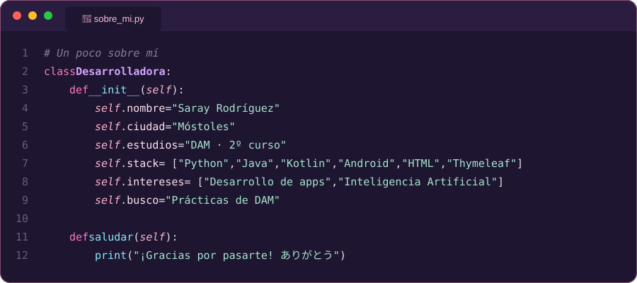

  

<h2 align="center">🌸 Sobre mí</h2>

  

  Estudiante de <b>Desarrollo de Aplicaciones Multiplataforma</b> con muchas ganas de aprender y crecer. 
  Me apasiona crear <b>apps</b> y todo lo relacionado con la <b>Inteligencia Artificial</b>.

---

## 🛠️ Tecnologías

  
  
  
  
  
  
  
  
  
  

## 🎯 Ahora mismo

- 📱 Cursando **2º de DAM**
- 🤖 Aprendiendo sobre **Inteligencia Artificial**
- 💼 **Buscando prácticas** en desarrollo de aplicaciones

## 📂 Proyectos

| Proyecto | Descripción | Tecnología |
|---|---|---|
| [Alohame](https://github.com/sarayasecas/alohame) | 🏝️ Plataforma web de alquiler vacacional: reservas, favoritos, comentarios, mensajes con el propietario, **mapa interactivo** de alojamientos y paneles para cliente, propietario y administrador. Incluye mejoras **SEO** y metadatos para redes sociales | Java · Spring Boot · Thymeleaf · MySQL · Leaflet |
| [Jumanji](https://github.com/sarayasecas/jumanji) | 🎲 Juego de tablero inspirado en la jungla: tablero de 25 casillas en espiral con casillas especiales (río, liana, león) y leyenda de reglas | Kotlin · Jetpack Compose |
| [Periódico digital](https://github.com/sarayasecas/periodico_digital_sr-main) | 🏍️ Periódico de noticias de MotoGP con HTML semántico, diseño **responsive** (mobile first) con Grid y Flexbox, menú fijo, animaciones de entrada y respeto por `prefers-reduced-motion` (accesibilidad) | HTML5 · CSS3 |
| [conteo_palabra](https://github.com/sarayasecas/conteo_palabra) | Script que cuenta cuántas veces aparece una palabra en un archivo de texto, con validación de entrada y limpieza de puntuación | Python |

---

  <i>ありがとう · ¡Gracias por pasarte!</i> 🌸

